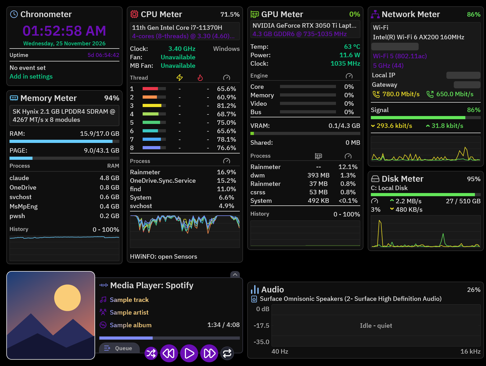
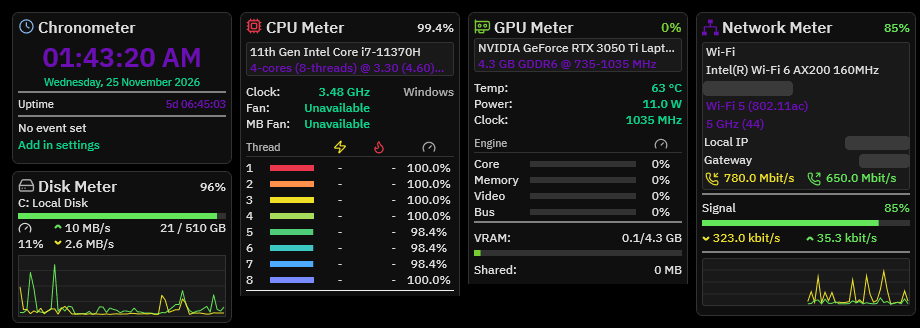

# Parallax

Parallax is a set of small desktop panels for Windows: a clock with timers, meters for the processor, memory, graphics card, disks and network, a media player, and an audio spectrum. It runs in [Rainmeter](https://www.rainmeter.net/), a free program that draws panels, called *skins*, on the desktop.

<!-- download-badge:start (rewritten by tools\Package-Parallax.ps1; do not edit by hand) -->

<!-- download-badge:end -->

**This is early software, and nobody outside the maintainer has run it yet.** Please read [what has been checked and what has not](#verified-and-not-yet) before you install it. Older versions are on the [releases page](https://github.com/davideAurum/Parallax/releases).

*The panels with their shipped settings, captured one by one on the maintainer's laptop and placed side by side. The readings are real; the Wi-Fi name and local addresses are covered. Media Player shows a made-up track and cover, and nothing was playing, so the Audio spectrum is idle. The laptop was busy and ran a second copy of Parallax for the pictures, so the Rainmeter lines do not show what Parallax costs.*

## What's included

Each panel works on its own, so use one or all of them.

| Panel (name in the Welcome list) | What it shows |
| --- | --- |
| **Chronometer** | Clock and date, time since Windows last restarted, a countdown to one event, and twelve countdown timers in three lists. The timers are hidden until you show them in the panel's settings. |
| **CPU Meter** (CPU) | Total load, load per thread, clock speed, the busiest programs and a history graph. Temperatures, voltages and fan speeds need [HWiNFO](#cpu-temperatures-voltages-and-fans-hwinfo). |
| **Memory Meter** (RAM) | Memory and page file in use, your memory modules, the programs using the most memory, and a history graph. |
| **GPU Meter** (GPU) | With an NVIDIA card: load, temperature, power, clock, video memory and the busiest programs, read from the graphics driver. With integrated graphics only: load and memory, without temperature, power or clock. |
| **Disk Meter** (IO) | Free space, read and write speed and load for the drives you pick (C: at first), a history graph, and an eject button for removable drives. |
| **Network Meter** (Network) | The adapter in use, its local address, Wi-Fi name, band and signal, download and upload speed, and a history graph. |
| **Media Player** (Media) | The current song with its cover, progress and playback buttons, in colors taken from the cover. A fold-out spectrum and an optional [Spotify queue](#spotify-queue-experimental). |
| **Audio** (Visualizer) | A spectrum of whatever the PC is playing. Click the output's name to switch to the next output device. |
| **Global Settings** | Size, width, colors, text sizes, how often panels refresh, pausing while you are away, and updates. A **Connections** panel shows what Parallax connects to. |

A reading that is not available shows as `--`, `-`, `Unavailable` or `Unsupported` instead of a guess. One exception is under [Known issues](#known-issues).

## Install

You need Windows 10 or 11. So far Parallax has only been tested on 11.

1. **Install Rainmeter** 4.5.26 or newer from [rainmeter.net](https://www.rainmeter.net/), if you don't have it.
2. **Download Parallax** with the button at the top of this page and double-click the `.rmskin` file. Rainmeter's Skin Installer opens. Click **Install**.
3. **Choose your panels.** A panel called **Welcome to Parallax** opens. Tick the panels you want, or click **Load all**. New panels open side by side from the top right of your main screen. Drag each one to where you want it; Rainmeter remembers their places.

The package also installs two small third-party Rainmeter plugins that Media Player uses, [WebNowPlaying](https://github.com/keifufu/WebNowPlaying-Rainmeter) and [Chameleon](https://github.com/socks-the-fox/chameleon), unless you already have a newer version of them.

### Using the panels

- **Settings for one panel:** move the pointer over the panel and click the gear that appears at its top right.
- **Settings for all panels:** right-click a panel and choose **Parallax settings**. On some panels it is inside **Custom skin actions**. This opens Global Settings.
- **Welcome panel:** close it when you are done. To bring it back, right-click Global Settings and choose **Open the Welcome panel**.

### Updates

**Global Settings > Updates** shows the installed version and has a **Check now** button. Parallax also looks for a new version [about once a day](#privacy). When there is one, a small prompt offers **Update**, which downloads the package, checks it and opens Rainmeter's Skin Installer for you to confirm. Your settings are kept.

### Removing it

1. If you signed in to Spotify, open **Connections** in Global Settings and click **Disconnect** first.
2. Click **Unload all** in the Welcome panel, then close it.
3. Delete the `Parallax` folder from Rainmeter's skins folder, usually `Documents\Rainmeter\Skins`.

A few small files stay behind. To delete them too, paste these paths into File Explorer's address bar:

- `%LOCALAPPDATA%\Parallax`: the whole folder, if it exists
- `%APPDATA%\Rainmeter`: the files whose names start with `Parallax-Chronometer`
- `%APPDATA%\Rainmeter\Plugins`: `WebNowPlaying.dll` and `Chameleon.dll`, unless another skin uses them

## Optional extras

Parallax works without any of these.

### Music and video in a browser: WebNowPlaying extension

Media Player follows desktop players that appear in Windows' own media controls, such as Spotify, without anything more. For players in a browser, add the [WebNowPlaying browser extension](https://wnp.keifufu.dev/extension/getting-started).

While a desktop player plays, a new install's title reads `Media Player: detection off`. To see **Spotify** there, click the title to open Media settings, then click **Start** under **Source detection**. This needs no sign-in. Other desktop players show as `Unknown`.

### CPU temperatures, voltages and fans: HWiNFO

CPU Meter takes these readings from [HWiNFO](https://www.hwinfo.com/) if you run it.

1. In HWiNFO, open **Sensors**, click the gear, open **HWiNFO Gadget** and turn on **Enable reporting to Gadget**.
2. Turn on **Report value in Gadget** for each reading you want: the **Core** temperatures, the **Core VID** voltages, and the CPU and motherboard fan speeds.
3. Click **OK**, then click **Scan sensors** in CPU Meter's settings, which also list these steps.

Keep HWiNFO running with its Sensors window open. Minimized is fine, but if the window is closed the readings stop, and CPU Meter says `HWiNFO: open Sensors`. Rainmeter's site has a [longer guide](https://docs.rainmeter.net/tips/hwinfo/).

### Spotify queue (experimental)

Media Player can list the songs Spotify plays next. You need both of these:

- **Spotify Premium.** Spotify requires it from the owner of a new developer app, which here is you.
- **Your own Spotify developer app.** Spotify allows only five people per new app, so Parallax cannot ship one for everybody.

The [queue setup guide](Skins/Parallax/@Resources/Modules/Media/Queue/README.md#connect-your-app) has the steps to make the app. You sign in from **Connections** in Global Settings. Until then, the open queue reads `Spotify queue is off: Connections`.

- The queue lists up to the next twenty songs. Roll the mouse wheel over it to scroll.
- Clicking a song plays it directly and keeps the songs in between, if it belongs to the album or playlist now playing. Otherwise Spotify skips to it, and the songs before it leave the queue.
- The **Playlists** view lists your first 50 playlists and starts the one you click. Spotify does not offer Liked Songs to apps, so they are not in the list.

Songs and playlists play on whichever device Spotify is using, so start Spotify first.

## Verified, and not yet

All checks so far ran on the maintainer's own two PCs.

### Verified

- Daily use of versions up to 0.1.0-alpha.13 on a desktop with Windows 11, an Intel Core i7-8700 (12 threads), an NVIDIA GTX 1080 and a 4K screen at 150%.
- Parts of 0.1.0-alpha.14 and 0.1.0-alpha.15 on a laptop with Windows 11, an Intel Core i7-11370H (8 threads), an NVIDIA RTX 3050 Ti and Intel Iris Xe graphics.
- Rainmeter 4.5.26 and 4.5.28.
- Installing over an existing copy keeps changed settings, and cancelling the installer changes nothing. This was one scripted test on the desktop, which reinstalled the same version.
- The update check reads the published release. The earlier updater, on the Welcome panel until October 2026, went from check to finished upgrade.
- Spotify with a real Premium account: signing in and disconnecting from the Connections panel, the queue and its covers, playing a song in a shuffled playlist, and the Playlists view.

### Not yet

- Anyone else's PC, and a first install on a PC that never had Parallax.
- **What it costs in processor time and memory.** The long measurement has not been run, so there is no figure to give.
- Windows 10, Windows in a language other than English, and ARM PCs.
- AMD processors, and AMD or Intel graphics cards.
- A PC with integrated graphics only. This was tried with the NVIDIA card hidden, not on a real one.
- A 1080p screen at 100% scaling, several screens with different scaling, and the look of 0.1.0-alpha.14 and later at 150%.
- Rainmeter's portable version, a standard (non-administrator) Windows account, a Windows user name with accents or non-Latin letters, and work PCs that block PowerShell scripts. Several panels use small hidden PowerShell helpers.
- Running for days, through sleep and wake.
- An update through the current prompt, followed from start to finish.
- Spotify with a Free account, on another device, or with more than 50 playlists. Scrolling the queue with a real mouse wheel, and a click on a song Spotify has to skip to.
- The cover's colors in the fold-out spectrum, or from a cover with little color.
- CPU Meter picking up HWiNFO again by itself after the readings stopped.
- The removal steps above.

### Known issues

- On a smaller screen some new panels open on top of one another, so drag them apart. A 1920 × 1080 screen has room for all of them at 100% Windows scaling. At 125% **Global Settings** covers part of three others, and at 150% **Welcome** is covered too. A panel that an older version left in the top-left corner stays there until you move it.
- Where the screen is too short for them, **Global Settings** and the CPU, Chronometer and GPU settings stop at its bottom edge and scroll: use the mouse wheel, or the two arrows beside the close button. **Media Player's settings** do not scroll yet. At 150% their controls from the Spotify queue's buttons down are below the screen; at 125% only the last row is, and only while the queue is expanded.
- On Intel processors whose name includes their base speed, CPU Meter can show `(4.60)` as the turbo speed whatever the real one is. It comes from a setting, not a reading. To fix it, right-click CPU Meter, choose **Edit CPU options**, change or clear `CPUTurboClock`, save, and refresh the panel.
- On Windows before 11 24H2, or in a language other than English, Network Meter reads `Band unavailable`.
- In Media Player's one-column layout, the right playback button covers part of the time.
- In Media Player's setup view, a queue that was left open shows its songs below the panel and cannot be closed there.

## Privacy

Parallax has no telemetry and no server of its own, and needs no account. Its settings stay on your PC. It uses the internet for two things:

- **The update check** reads one small file from this project's GitHub releases, about once a day while a panel is loaded, and when you open Global Settings. It sends nothing about you or your PC beyond what any download does: GitHub sees your IP address, and it counts downloads, which is all this project can see. To turn it off, set **Global Settings > Updates > Auto check** to **Off**. After that, only **Check now** and **Update** contact GitHub.
- **Spotify**, only after you sign in for the queue. Parallax then contacts Spotify's sign-in service, its Web API and its cover-image servers. The sign-in is kept on your PC, encrypted by Windows for your user account, and **Disconnect** deletes it. Parallax never sees your Spotify password, and it does not use a client secret.

Spotify detection, HWiNFO readings and Network Meter's addresses come from your own PC, and Parallax does not look up your public address. Rainmeter, WebNowPlaying and HWiNFO are separate programs with their own rules.

## Report a bug

[Open an issue](https://github.com/davideAurum/Parallax/issues/new/choose) and pick the bug form or the feature-request form. You need a free GitHub account. The bug form asks for:

- your Windows and Rainmeter versions: right-click Rainmeter's icon in the taskbar's notification area, choose **About**, then **Version**
- your Parallax version, beside **Updates** in Global Settings
- your processor, graphics card and display scaling
- which panel it was, and what happened
- the lines about Parallax in Rainmeter's log: **About**, then **Log**. Leave it open, right-click the panel, choose **Refresh skin**, and copy what appears

Issues are public. Remove your Windows user name, Wi-Fi name and anything else personal first. Never paste sign-in codes or tokens, and never attach files from `%LOCALAPPDATA%\Parallax`.

## Credits and license

Parallax's dense black layout was inspired by [ModernGadgets](https://github.com/raiguard/ModernGadgets) by raiguard. Parallax uses none of its code or artwork and is not connected with it. The bundled parts keep their own licenses: IBM Plex Sans (SIL OFL 1.1), WebNowPlaying (MIT), Chameleon (BSD 3-Clause) and Lucide icons (ISC and MIT). See [NOTICE.txt](Skins/Parallax/@Resources/Licenses/NOTICE.txt).

Parallax itself is released under the [MIT License](LICENSE). To build or change it, start with [docs/DEVELOPMENT.md](docs/DEVELOPMENT.md).
